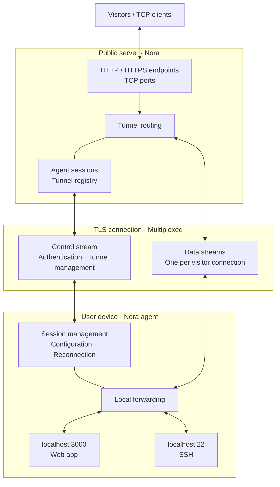

# Nora

A self-hosted alternative to ngrok, written in Go. The goal is to expose local services to the internet through a public server and an agent running on your machine.

## Status

Work in progress. The original single-connection TCP prototype is being refactored into an agent/server architecture with YAML configuration, authentication messages, and yamux sessions.

The current source does not compile yet: configuration usage and parts of the server implementation are incomplete. The architecture below describes the intended design, not a working feature set.

## Agent configuration

The YAML loader currently defines the following fields:

```yaml
authtoken: "<your_auth_token>"
server-addr: "127.0.0.1:9000"
tunnels:
  frontend:
    proto: http
    port: 3000
  backend:
    proto: tcp
    port: 8080
```

- `authtoken`: agent authentication token.
- `server-addr`: address of the Nora server, including its port.
- `tunnels`: named local services; `proto` specifies the intended tunnel type and `port` the local application port.

These fields describe the configuration format under development. HTTP routing, protocol validation, and tunnel registration are not complete.

Use `--config /path/to/config.yml` to select a configuration file. Without the flag, Nora uses:

| OS | Default path |
| --- | --- |
| macOS | `~/Library/Application Support/nora/nora.yml` |
| Linux | `$XDG_CONFIG_HOME/nora/nora.yml`, or `~/.config/nora/nora.yml` if unset |
| Windows | `%LocalAppData%\nora\nora.yml` |

An explicit path replaces the default. Nora does not search the current directory or create a missing file; errors include the selected path. Full startup instructions will be added once the build is restored.

Keep configuration files containing real tokens outside version control, for example in the ignored `.local/` directory.

## Planned architecture



In the planned design, one agent maintains one outbound TLS connection to the server. Multiple tunnels and visitor connections share it through separate logical streams using yamux.

## Planned

- Multiple tunnels and concurrent connections
- An API for creating and managing tunnels
- Custom subdomains for HTTP services
- Agent authentication and TLS
- Automatic reconnection
