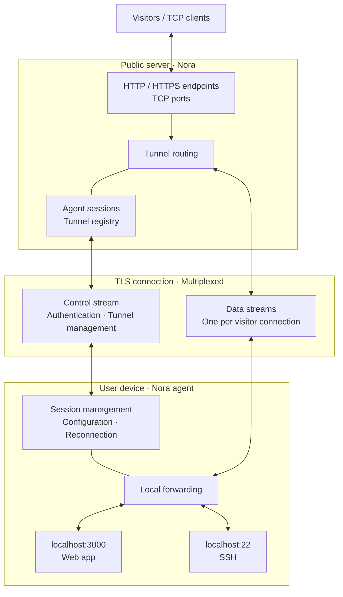

# Nora

A self-hosted alternative to ngrok, written in Go. The goal is to expose local services to the internet through a public server and an agent running on your machine.

## Status

Early prototype: forwards TCP traffic through a single agent connection. Currently supports one visitor connection per run, with hardcoded ports and no authentication or encryption.

## Planned architecture

One agent maintains one outbound TLS connection to the server. Multiple tunnels and visitor connections share it through separate logical streams.

## Planned

- Multiple tunnels and concurrent connections
- An API for creating and managing tunnels
- Custom subdomains for HTTP services
- Agent authentication and TLS
- Automatic reconnection
